# Strata — Music Player for Android

> **AI slop. Do not consider this my project.**
> All the code, tests and this README were generated by an AI model (Claude).
> The repository is public only so GitHub Actions can build the APK. Don't use it as an example of good Android code.

A local-file music player for Android, loosely inspired by foobar2000 and Samsung Music.
Kotlin, Jetpack Compose, Media3/ExoPlayer.

## Screenshots

<table>
  <tr>
    <td align="center">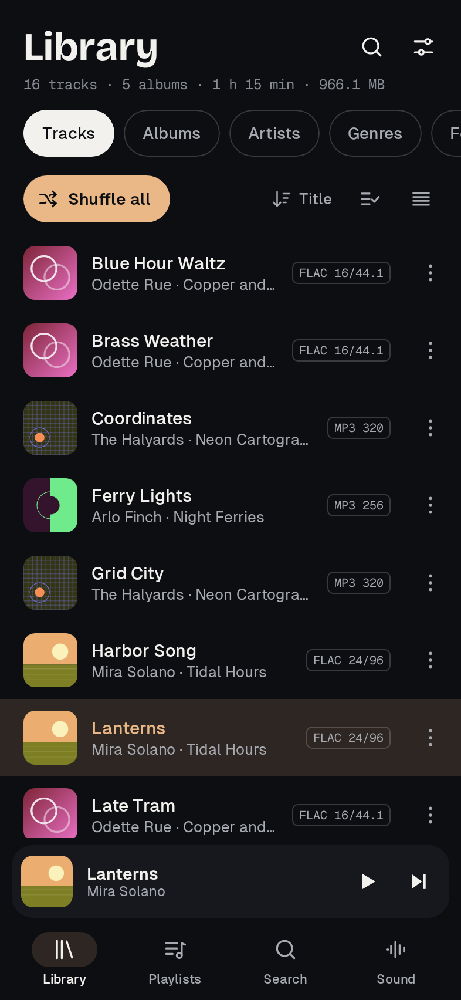<br><sub>Library</sub></td>
    <td align="center">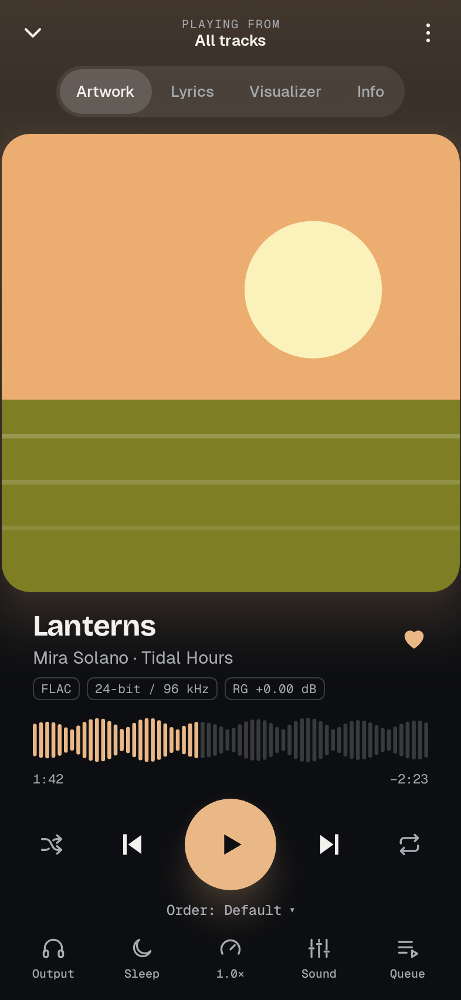<br><sub>Now playing</sub></td>
    <td align="center">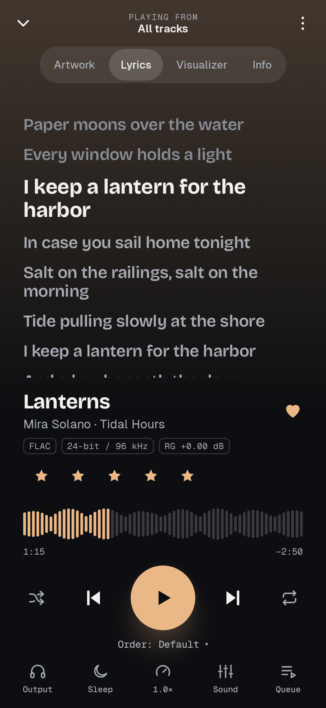<br><sub>Synced lyrics</sub></td>
    <td align="center">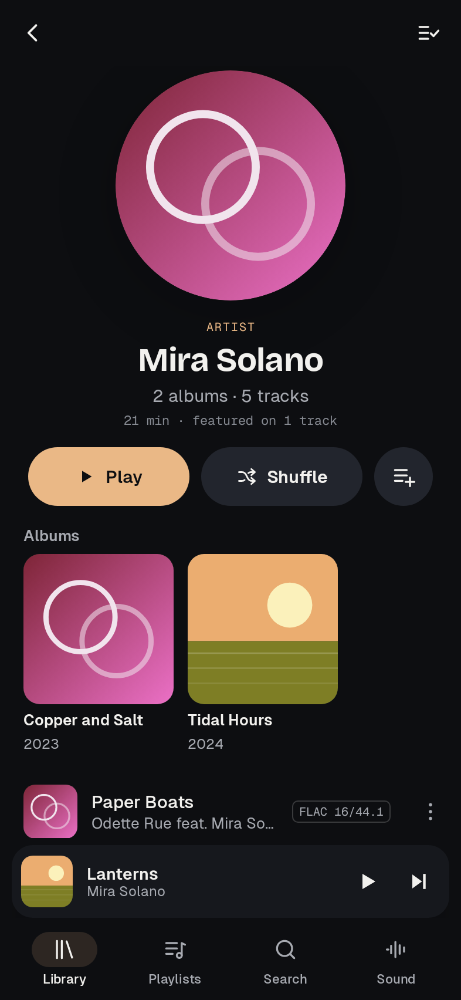<br><sub>Artist page with features</sub></td>
  </tr>
  <tr>
    <td align="center">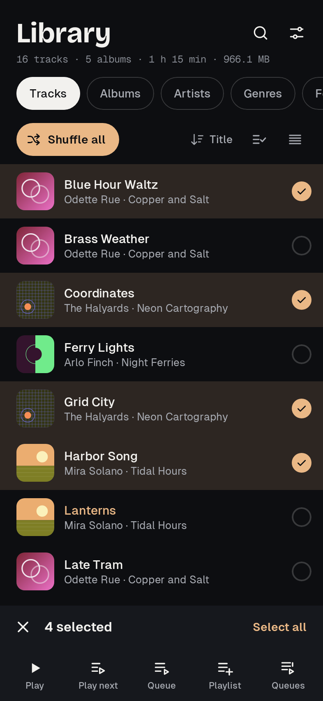<br><sub>Multi-select</sub></td>
    <td align="center">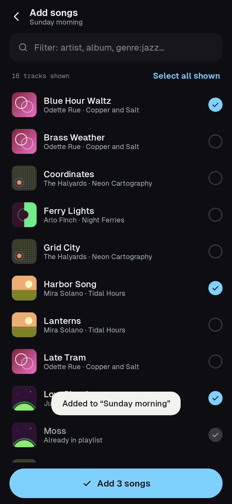<br><sub>Playlist song picker</sub></td>
    <td align="center">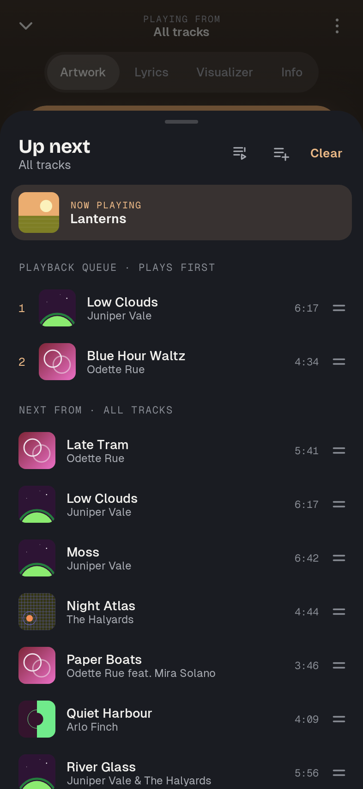<br><sub>Queue</sub></td>
    <td align="center">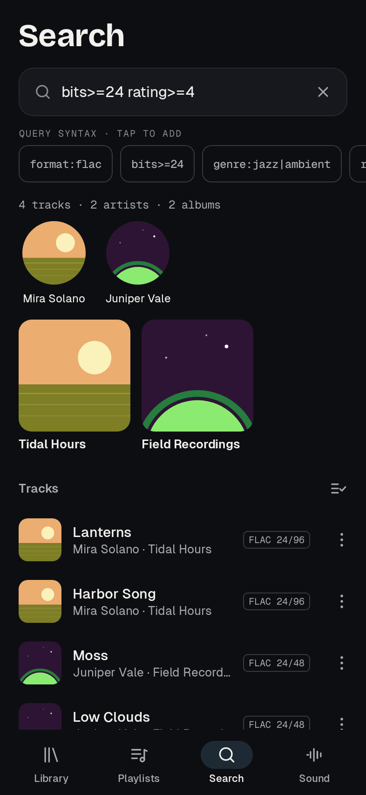<br><sub>Query search</sub></td>
  </tr>
  <tr>
    <td align="center">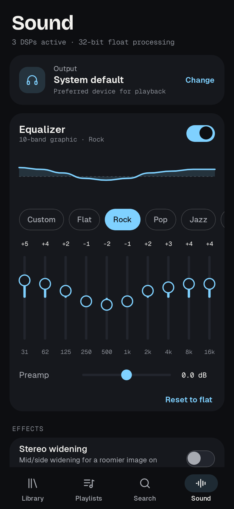<br><sub>Sound / EQ</sub></td>
    <td align="center">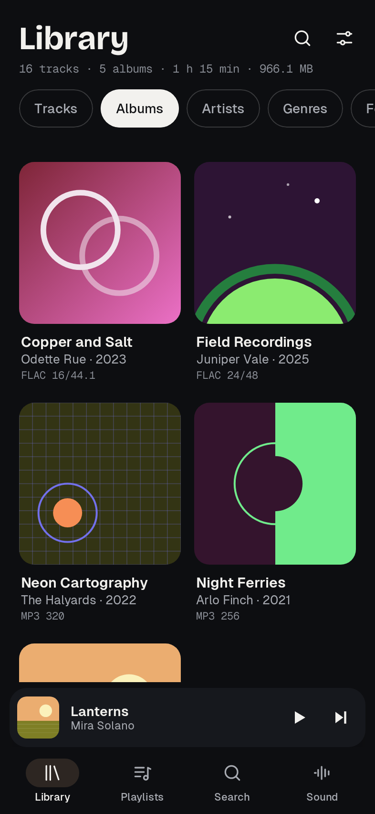<br><sub>Albums</sub></td>
    <td align="center">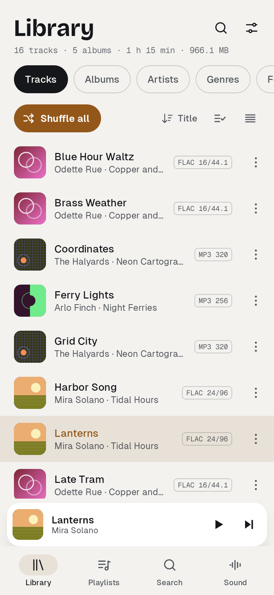<br><sub>Light theme</sub></td>
    <td align="center">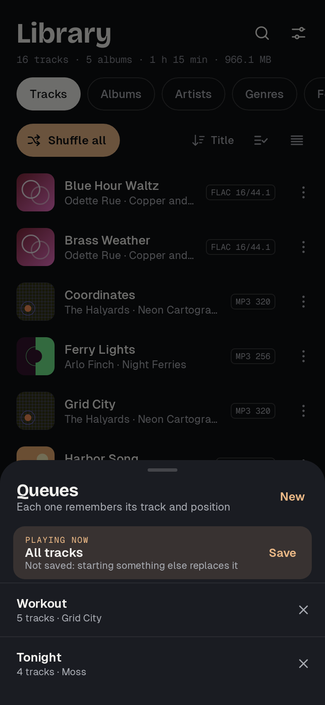<br><sub>Saved queues</sub></td>
  </tr>
  <tr>
    <td align="center">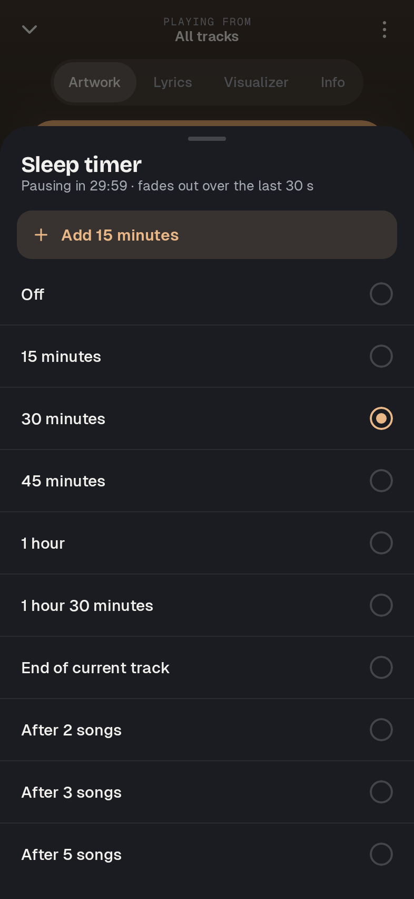<br><sub>Sleep timer</sub></td>
    <td align="center">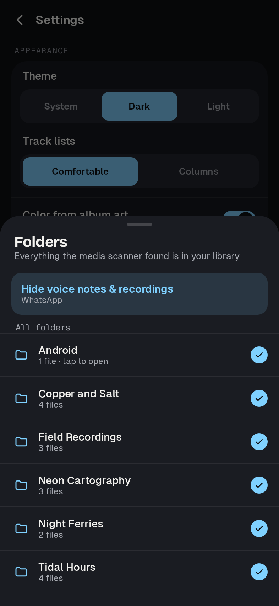<br><sub>Folders</sub></td>
    <td align="center">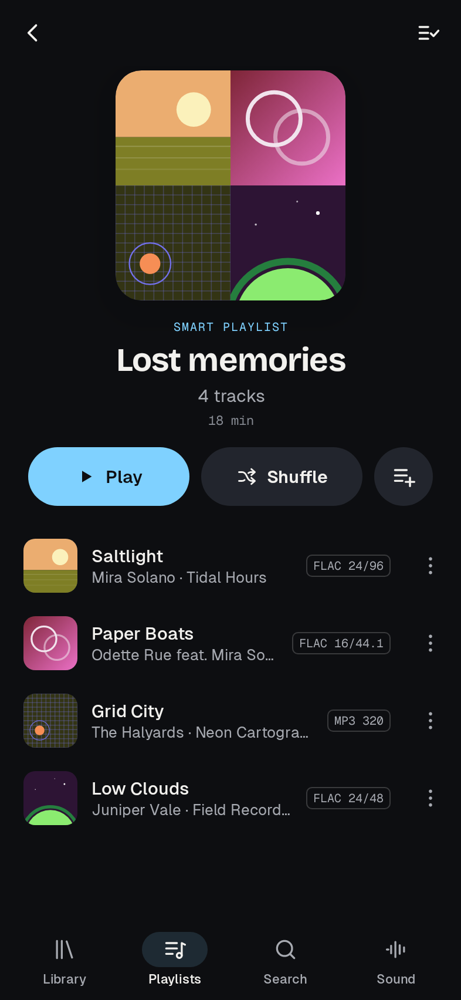<br><sub>Lost memories</sub></td>
    <td align="center">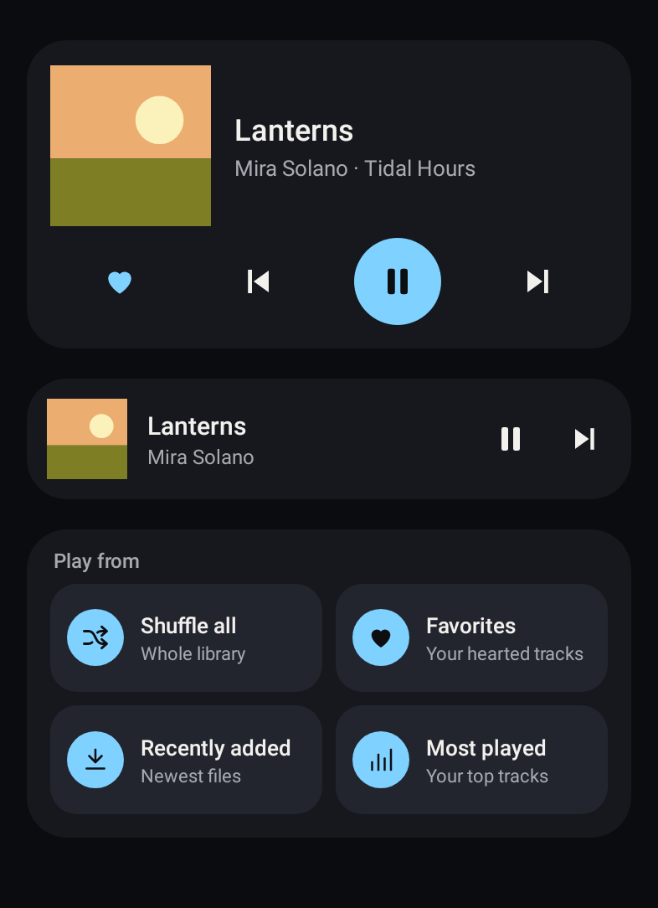<br><sub>Home-screen widgets</sub></td>
  </tr>
  <tr>
    <td align="center"><br><sub>Hearting a track</sub></td>
    <td align="center"><br><sub>Swiping to the next track</sub></td>
    <td align="center"><br><sub>Reordering a playlist</sub></td>
    <td align="center"><br><sub>Backup and restore</sub></td>
  </tr>
</table>

<sub>Rendered from the real app with a made-up sample library (GitHub Actions, <code>ScreenshotTest</code>). Album covers are the app's generated artwork.</sub>

## Building

GitHub Actions builds it on every push: the APKs appear under **Actions → latest run → Artifacts → Strata-apk**.
Stable builds are attached to the [Releases](../../releases) page.

To build locally with the Android SDK installed:

```
./gradlew assembleRelease
```

The APK lands in `app/build/outputs/apk/release/`. Every build runs the unit and UI tests first (`./gradlew testDebugUnitTest`).

**Signing.** Builds are signed with one permanent key kept in two repository secrets,
`STRATA_KEYSTORE_B64` (the keystore, base64) and `STRATA_KEYSTORE_PASSWORD`, so each new APK installs over the
previous one and keeps your data. Without the secrets (a fork, a local build) it uses a throwaway debug key, and that
APK won't install over one signed with the permanent key. Settings → About shows the build number.

## What's inside

**Library** — Tracks, Albums, Artists, Genres, Folders and Composers tabs. Sort by title, artist, album, date added, plays or length.
Comfortable rows or a dense column view (#, title, format, time). Format badges read from the files (e.g. `FLAC 24/96`, `MP3 320`).
Files shorter than 30 seconds can be ignored, and any folder can be left out
(one tap hides WhatsApp voice notes and call recordings). Lists use natural sorting ("Track 2" before "Track 10").

**Artists** — tracks credited to several artists ("A feat. B", "A & B", "Song (feat. B)") appear on every artist's page.
Band names like Simon & Garfunkel or AC/DC stay together, and you can add your own "never split" names in Settings.

**Multi-select** — long-press a track to start selecting, tap to add more, long-press again to select a range.
Then play, play next, add to the queue, add to a playlist or a saved queue, or remove from the current playlist.

**Playlists** — Favorites, Most played, Recently played, Recently added and Lost memories
(songs you played a lot, but not in the last six months); your own playlists (drag the handle to reorder, remove with Undo, rename, delete);
auto playlists that fill themselves from a search query. A new playlist opens a song picker with a filter and "select all shown",
and album/artist pages can add all their tracks at once.

**Now playing** — artwork, synced lyrics (embedded tags or a sidecar `.lrc`; tap a line to seek), a visualizer
(spectrum, oscilloscope, peak meter) and a technical info panel. The seek bar is a waveform decoded from the file.
Album art colors tint the app.
Small things move: the heart pops with a burst (and a haptic tick), stars fill one after another, play/pause morphs,
the title slides in on a track change, buttons give a little when pressed, and lists animate when rows are added,
removed or reordered. All of it is short and finite; nothing animates while the screen is idle.

**Playback** — playback orders: Default, Repeat playlist, Repeat track, Random, Shuffle tracks, Shuffle albums, Shuffle folders
(long-press shuffle plays one random track). A playback queue that plays before the rest of the list, gapless playback,
speed 0.5–2× with keep-pitch, skip silence, fade between tracks, preferred output device,
background playback with notification, lock-screen and Bluetooth controls (with a heart to favorite the playing track).
Swiping Strata away from recent apps stops the music, like other players ("Keep playing after closing" in Settings if you want it to continue).
Pauses when headphones disconnect and resumes when they connect again (Bluetooth resume is opt-in).
Files longer than 10 minutes (mixes, audiobooks) remember where you stopped.
Easy on the battery: during playback the app wakes about once a second (ten times only while a fade is running),
saves a few bytes every 15 seconds, and on-screen clocks stop updating when the app is in the background.
The last library scan is kept, so the library shows up immediately on launch while a fresh scan runs.

**Gestures** — swipe the mini player or the cover left/right to skip: the next (or previous) track's cover slides in
with the finger, already loaded, and a quick flick is enough. A swipe back always goes to the previous track.
Swipe the mini player up to open the player,
the cover up to open the queue; double-tap the right/left half of the cover to jump 30 seconds forward/back.
Star rating right on the player screen.

**Your data** — Settings → Your data exports everything worth keeping (playlists, favorites, ratings, play history,
saved queues, settings) to one file wherever you choose, and restores it; songs are matched by file and tags, so a
backup also works on a new phone. Android's own backup keeps the same files (not the caches).
If Strata ever crashes, Settings → About offers the crash report to copy.

**Queue** — drag the handle to reorder, swipe right to play next, swipe left to remove (with Undo),
"Jump to current", and save the queue as a playlist.
**Several queues** can be kept at once: build tonight's queue while another one plays (add songs from any track menu
or a multi-selection), switch between them, and each one keeps its own track and position.

**Sleep timer** — minutes, end of the current track, or after 2/3/5 songs. It fades out instead of cutting off,
and "Add 15 minutes" extends a running timer.

**Widgets** — "Now playing" (resizes from a slim strip to a full player with cover, elapsed time and controls)
and "Play from" (one-tap shuffle all, favorites, recently added, most played; the tile that's playing is highlighted
and pauses on tap). Track changes crossfade, play/pause and the heart pop, buttons ripple.
Nothing runs in the background for them: they update only on player events, and the elapsed time is ticked by the launcher itself.

**Sound** — 10-band EQ with presets and preamp, ReplayGain (track / album / smart, preamps, clipping prevention) read from your tags,
stereo widening, mono downmix, balance, limiter, and a reorderable DSP chain.

**Search** — instant search plus a query language: `artist:`, `genre:jazz|ambient`, `format:flac`, `bits>=24`, `rate:96`,
`rating>=4`, `plays>10`, `year:2024`, `length>360`, `fav:1`, `-genre:podcast`, `"quoted phrases"`.
`artist:` also matches featured artists.

**Properties** — metadata, technical details (sample rate, bit depth, ReplayGain values, tag type) and play statistics with star ratings.

## Known limits

- **Tag edits** are stored in the app's own library; the audio files are not rewritten.
- **ReplayGain** is read from existing tags; the app doesn't scan loudness.
- **Fade** fades out and in at track changes; it is not an overlapping crossfade.
- No converter and no bit-perfect USB output.
- No Android Auto or playlist import/export (.m3u) yet.
- Dragging a playlist row works within what's on screen; for long moves use "Move up/down" in the track menu.

## Project layout

```
app/src/main/java/com/strata/player/
  AppModel.kt               app state, navigation, playlists, selection, settings
  audio/Engine.kt           ExoPlayer, playback orders, queue, sleep timer, fades
  audio/Dsp.kt              EQ, ReplayGain, widening, limiter, FFT analyzer
  audio/PlaybackService.kt  background playback + media notification
  data/                     MediaStore scan, tag/LRC parsers, artist splitting, natural sort, query language, JSON storage
  ui/                       Compose screens (QueueSheets.kt: queue, saved queues, sleep timer, folders;
                            Motion.kt: animations, haptics and the swipe-between-tracks cover)
  widget/StrataWidgets.kt   home-screen widgets
app/src/test/java/com/strata/player/
  CoreLogicTest.kt, ArtistSplitTest.kt         parser, DSP and artist-splitting checks
  QolLogicTest.kt                              queue editing, saved queues, sleep timer, folders, widgets
  EfficiencyTest.kt                            disk writes, ticker timing, search, library snapshot
  DataSafetyTest.kt                            backup & restore, playlist undo, notification heart, crash report
  UiTest.kt, ArtistsAndSelectionUiTest.kt,
  QolUiTest.kt                                 Robolectric tests that tap and swipe through the real UI
```

Fonts: Bricolage Grotesque and Geist, under the SIL Open Font License (see `licenses/`).
